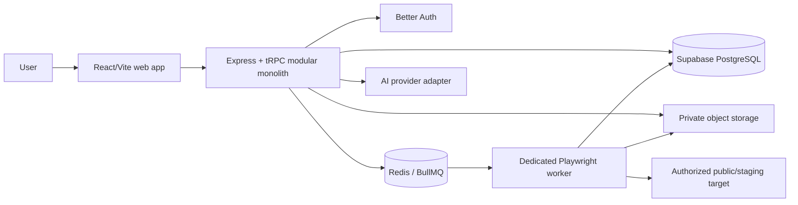
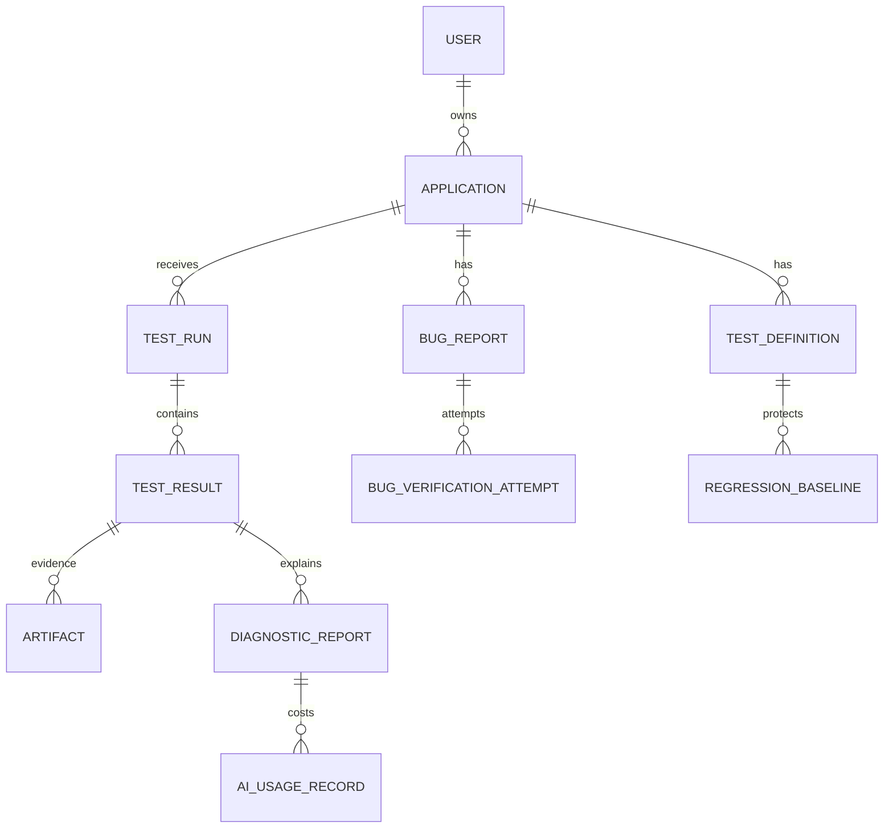

# App Doctor / Launch Guard — Product Requirements Document

## 1. Scope, objectives, and personas

App Doctor is a modular-monolith SaaS that independently tests authorized web applications and reports evidence-based Health Scan, Bug Verification, and Regression Guard results. The MVP objective is safe, repeatable browser verification for small teams; it is not a universal correctness proof or code-repair service.

**Founder/vibe coder:** needs a simple “what broke and what did you observe?” answer. **Developer:** needs repeatable steps and debugging evidence. **Future workspace admin:** needs ownership, auditing, and safe project access. MVP launches with an owning user and data model ready for roles later.

Success metrics: ≥90% of accepted jobs reach a terminal state; median first Health Scan result is understandable without support; saved tests can be rerun with comparable inputs; zero known cross-tenant data exposures; and diagnostic reports never state hypotheses as observations.

## 2. Functional requirements and acceptance criteria

| Area | Requirement | Acceptance criterion |
|---|---|---|
| Applications | Authenticated owners create, view, edit, and archive authorized app environments. | A user cannot read or mutate another user’s application by ID. |
| Health Scan | Queue bounded deterministic checks and persist per-check outcomes/evidence. | A run reports passed, failed, skipped, or inconclusive checks with reasons. |
| Bug verification | Capture report, prerequisites, user-reviewed test definition, attempts, and comparisons. | A fix is “verified” only when the approved reproduction test passes. |
| Regression Guard | Save versioned critical tests and successful baseline results; compare reruns. | An equivalent baseline pass followed by a required-check failure creates a regression finding. |
| Reporting | Present simple summary and full technical detail/evidence to authorized users. | Reports distinguish observation, warning, and hypothesis. |
| Diagnostics | Invoke an AI provider only for opted-in/eligible complex failures. | Provider failure leaves deterministic report usable and reveals no secret value. |
| Operations | Queue, cancellation, timeout, retry policy, and terminal persistence. | A worker crash does not leave an indefinitely “running” database result. |

Nonfunctional requirements: TypeScript end-to-end; responsive accessible UI; validated inputs; paginated lists; UTC timestamps; structured logs and correlation IDs; idempotent enqueueing; auditability; and retention/deletion behavior. Availability targets are aspirational until measured; security controls are release blockers.

## 3. Mandatory stack and integration

| Component | MVP choice | Role |
|---|---|---|
| Frontend | React, TypeScript, Vite, Tailwind CSS | SPA dashboard and accessible forms. |
| Backend | Node.js, Express, TypeScript | HTTP host, auth handler, health/webhook endpoints. |
| API | tRPC | Typed protected procedures for application data. |
| Database | Supabase PostgreSQL | Durable relational source of truth. |
| ORM | Drizzle ORM + Drizzle Kit | Typed schema, queries, and reviewed migrations. |
| Authentication | Better Auth + supported Drizzle/Postgres adapter | Email/password, sessions, verification, recovery. |
| Browser engine | Playwright | Isolated server-side browser workflows. |
| Jobs | BullMQ + Redis | Durable enqueueing, worker lifecycle, backoff and concurrency. |
| Artifacts | S3-compatible private object storage | Screenshots/traces; metadata stays in Postgres. |
| AI | OpenAI API behind an internal diagnostics adapter | Structured optional diagnostics. |

Better Auth owns its generated `user`, `session`, `account`, and `verification` tables (plus enabled-plugin tables). Generate its Drizzle schema from its current CLI/configuration and version it in the same reviewed Drizzle migration flow; do not hand-invent divergent auth tables. Application-domain user references use the Better Auth user ID type.

## 4. Architecture

The frontend contains route-level pages, shared UI, typed tRPC client, and no privileged credentials. The backend separates auth middleware, routers, Zod validation, services, repositories, queue producer, artifact signer, AI adapter, and audit logger. The worker is a separate deployable process/container with its own least-privilege credentials, browser lifecycle, egress policy, and no public HTTP port. PostgreSQL remains authoritative for user-visible job/test state; Redis is transient queue coordination.

Suggested tRPC routers: `dashboard`, `applications`, `testDefinitions`, `testRuns`, `bugReports`, `regression`, `diagnostics`, and `artifacts`. Every protected procedure resolves the session, validates input, and performs ownership checks in the service/repository query—not only in the UI. Express routes remain for Better Auth mounting, `/healthz`, `/readyz`, optional signed webhook receivers, and only future integration callbacks.

## 5. Data design

All domain IDs are PostgreSQL UUIDs (`gen_random_uuid()`); timestamps are `timestamptz`; money/token counts are integers; JSON payloads are constrained to documented metadata rather than core relations. Soft archive is preferred for applications; audit records are append-only. Screenshots are never BLOB columns.

| Table | Purpose, key fields, constraints/indexes |
|---|---|
| `applications` | `id`, `owner_user_id` FK, name, base_url, environment, authorization_attested_at, archived_at, timestamps. Unique `(owner_user_id, normalized_base_url, environment)`; index owner/updated. |
| `application_credentials` | Encrypted secret reference/ciphertext metadata, app FK, label, purpose, expiry, timestamps. No plaintext retrieval in normal reads; index app. |
| `test_definitions` | `id`, app FK, kind, name, version, status, steps JSONB, preconditions JSONB, side_effect_level, created_by, timestamps. Unique `(id, version)` and app/status index. |
| `test_runs` | `id`, app FK, trigger, status, requested_by, queue_job_id unique, started/finished/cancelled timestamps, config snapshot, correlation ID. Index app/created and status/created. |
| `test_results` | `id`, run FK, definition FK nullable, sequence, outcome, assertion, message, duration, evidence summary. Unique `(run_id, sequence)`; run/outcome index. |
| `bug_reports` | `id`, app FK, reporter FK, title, description, expected, actual, status, timestamps. App/status index. |
| `bug_verification_attempts` | `id`, bug FK, run FK unique, definition version, outcome, compared_attempt_id nullable, verified_at. Bug/created index. |
| `regression_baselines` | `id`, definition FK, baseline_result FK, environment fingerprint, active flag, selected_by, timestamps. One active baseline per definition/environment via partial unique index. |
| `regression_findings` | `id`, baseline FK, current result FK, severity, status, comparison JSONB, timestamps. Unique baseline/current-result. |
| `artifacts` | `id`, result FK, storage_key unique, type, content_type, byte_size, checksum, redaction state, retention/delete timestamps. Result index. |
| `diagnostic_reports` | `id`, run/result FK, provider/model, status, structured output JSONB, prompt version, timestamps. Result/created index. |
| `ai_usage_records` | `id`, diagnostic FK, provider/model, input/output token counts, estimated cost, status, timestamps. Created/provider index. |
| `audit_events` | `id`, actor user FK nullable, app FK nullable, action, target type/id, safe metadata JSONB, IP hash, timestamp. App/timestamp index. |

Migrations are generated by Drizzle Kit, committed, reviewed, tested against ephemeral Postgres, and applied once by CI/CD. Use DB foreign keys, `NOT NULL`, checks for enums/ranges, and indexes stated above; do not rely on frontend validation. App-level authorization is enforced server-side; Supabase direct browser access is not used for MVP.

## 6. API contract

All tRPC procedures return typed envelopes or mapped domain errors: `UNAUTHORIZED`, `FORBIDDEN`, `NOT_FOUND` (without existence leakage), `BAD_REQUEST`, `CONFLICT`, `RATE_LIMITED`, and `INTERNAL_SERVER_ERROR` with correlation ID. Cursor pagination uses opaque cursor plus bounded `limit`.

| Router | Procedures |
|---|---|
| `applications` | `list`, `get`, `create`, `update`, `archive` |
| `testRuns` | `startHealthScan`, `get`, `list`, `cancel`, `getResults` |
| `testDefinitions` | `list`, `createDraft`, `updateDraft`, `publish`, `archive` |
| `bugReports` | `list`, `create`, `get`, `update`, `approveReproduction`, `verify` |
| `regression` | `setBaseline`, `listBaselines`, `rerun`, `listFindings`, `resolveFinding` |
| `diagnostics` | `request`, `get` |
| `dashboard` | `summary`, `activity` |
| `artifacts` | `requestViewUrl` |

`startHealthScan`, `verify`, and `rerun` return `{ runId, status: "queued" }` only after a transaction records a pending run and an outbox/producer safely enqueues it. `getResults` returns check state, human message, artifact metadata, and no secret fields. Artifact access produces a short-lived signed URL only after ownership verification. Standard Express endpoints: Better Auth handler; liveness/readiness; narrowly verified webhook route(s) only when integrations ship.

## 7. Testing engine and background jobs

The API creates a run and queue job; the worker atomically claims it, marks it running, revalidates target safety, obtains limited-use encrypted credentials, starts one isolated Playwright browser context, executes a versioned definition, streams safe progress, uploads artifacts, persists results, then closes context/browser in `finally`. Contexts never cross users/runs. Per-step, navigation, and total-run timeouts are separate. Failure screenshots are default; traces/videos are opt-in and retention-limited.

Initial deployment uses one dedicated worker with global browser concurrency **1** on a constrained VPS, then raises only after memory measurements. Queue concurrency alone is not a safe browser capacity setting. Use per-user/app queue quotas, deduplicated active runs, max pages/redirects/actions/request bytes, and cancellation via persisted flag plus worker abort/close. Retry only transient infrastructure errors with bounded exponential backoff; never automatically retry an app assertion failure, unsafe target decision, cancellation, or side-effecting test. A reconciliation process marks stale running jobs terminal and captures worker-loss reason.

Health Scan tests are a curated, bounded suite; user flows are explicit versioned step definitions. URL-only scans never claim arbitrary business logic coverage. Network and console events are captured with redaction; HTTP bodies are not blindly stored. Test credentials use dedicated staging accounts and injected secrets, never browser-visible reports.

## 8. AI diagnostics

Define an internal `AiDiagnosticsProvider` interface that accepts a schema-validated redacted evidence bundle and returns a schema-validated report: `summary`, `confirmedObservations[]`, `hypotheses[]` (with confidence/evidence), `recommendedActions[]`, `repairPrompt`, `limitations`. The MVP implementation uses the OpenAI API through this boundary, so provider calls, response parsing, and cost records are not scattered through business logic. The OpenAI key is loaded only from the server environment or a secret manager; it is never sent to the frontend. Model selection is environment-controlled and will be chosen during implementation based on approved quality, latency, and cost targets.

Invoke only after a failed/inconclusive result and user/plan policy permits it. Enforce per-user quotas, max evidence/token size, request rate limits, timeout/circuit breaker, token/cost records, and prompt-version tracking. Strip cookies, authorization headers, credentials, personal data where practical, and signed URLs; store only approved artifact derivatives. On provider error, save an unavailable diagnostic status and show deterministic results. Users can disable AI diagnostics; retention/deletion must include derived prompts where applicable.

## 9. Security and safety requirements

Threat model release requirements:

- **SSRF/DNS rebinding/redirects:** canonicalize URL; allow HTTPS (HTTP only local development); resolve and reject loopback, link-local, RFC1918, carrier-grade NAT, multicast, unspecified, IPv6 local/private, and cloud metadata ranges before navigation and each request/redirect; pin/recheck DNS; enforce proxy/firewall egress allow rules. Do not trust a single initial DNS lookup.
- **Browser containment:** run unprivileged isolated container/process, no host mounts or Docker socket, immutable image, patched browser, resource/cgroup limits, no internal network route, and discard contexts after every run.
- **Authorization and abuse:** ownership checks in every query, secure HTTP-only/SameSite cookies and production Secure flag, CSRF/origin protections per Better Auth guidance, password recovery/verification, rate limits on auth and job creation, test authorization attestation, quotas, audit events, and no default write/purchase actions.
- **Data protection:** TLS, encrypted secrets with managed KMS/key rotation, private object storage, signed URLs, artifact/log redaction, minimum retention, deletion jobs, backup encryption, and no credential values in telemetry or AI prompts.
- **Supply chain/operations:** pinned dependency updates, secret manager, least-privilege service accounts, vulnerability scanning, structured security logs, and incident/runbook procedures.

## 10. Production infrastructure

Start with a reverse proxy/HTTPS endpoint, stateless Express API, one Playwright worker container, managed Supabase Postgres, self-hosted Redis on the same VPS/private network, and private AWS S3 object storage. Redis must bind only to loopback/private networking, require authentication, have an explicit `maxmemory` limit and `noeviction` policy for BullMQ safety, and be monitored; begin with a measured conservative limit such as 256 MB rather than exposing it publicly. A practical starting worker needs 2 vCPU and 4 GB RAM; API can start at 1–2 vCPU/1–2 GB. Treat this as a measurement starting point, not a per-test RAM promise. Keep browser concurrency at one first. Frontend can be static-hosted. Separate development/staging/production projects, URLs, credentials, queues, buckets, and AI keys.

Required environment groups: database URL/pool configuration; Better Auth secret/base URL/email provider; VPS Redis URL/password/queue prefix; AWS S3 bucket/region/least-privilege credentials; OpenAI model/key; encryption/KMS key reference; allowed-origin; worker limits; log/error-reporting DSN. Do not commit values. S3 remains private with Block Public Access enabled; the application uses short-lived presigned URLs after authorization checks.

Monitor queue depth/age, run terminal rate, worker restarts/RSS, browser failures, DB connections, artifact errors, AI error/cost, SSRF rejections, and auth failures. Use correlation IDs across API/worker. Daily encrypted DB backups with tested point-in-time recovery where service permits; object-storage versioning/lifecycle; documented restore drill. CI runs lint/typecheck/unit tests, integration tests against ephemeral services, Playwright worker tests against controlled fixtures, migration checks, and dependency/security scans. Deploy migrations before compatible application code; health checks and rollback preserve schema compatibility.

Initial costs are primarily a small VPS/managed compute, Redis, object storage/egress, Supabase plan, transactional email, observability, and metered AI usage. Keep cost controls in product quotas; verify provider pricing during procurement rather than hardcoding estimates.

## 11. Delivery roadmap

| Phase | Deliverables and dependencies | Acceptance criteria |
|---|---|---|
| 0 — Validation | Approve this PRD; threat-model review; choose storage, Redis, email, and AI providers. | Decisions and risk owners recorded. |
| 1 — Foundation | Monorepo/app setup, React/Vite/Tailwind, Express/tRPC, Drizzle/Supabase, Better Auth. | Protected typed hello/dashboard route and reviewed migrations work. |
| 2 — Application management | Application CRUD, ownership controls, authorization attestation, audit events. | Cross-user access tests pass; unsafe URL is rejected. |
| 3 — Worker safety | Redis/BullMQ, run state, dedicated Playwright worker, containment and egress controls. | Queued/cancelled/stale jobs reach accurate terminal state. |
| 4 — Health Scan | Curated safe checks, artifact pipeline, results UI. | Controlled fixtures yield correct pass/fail/inconclusive evidence. |
| 5 — Bug Verification | Intake, draft/approved definitions, attempt comparison. | Reproduced and verified-fix semantics are enforced. |
| 6 — Regression Guard | Baselines, reruns, comparisons/findings. | A fixture regression is detected without false comparison after version change. |
| 7 — AI diagnostics | Provider abstraction, redaction, quotas, report UI. | Provider outage and redaction tests pass. |
| 8 — Hardening | Load/security testing, backups, observability, deployment runbooks. | Threat-model release checklist and recovery drill pass. |

## 12. Assumptions, risks, and decisions needed

Assumptions: MVP targets applications the user owns or is explicitly authorized to test; staging is preferred; users provide dedicated test accounts; English is initial UI language; GitHub is postponed. Confirmed infrastructure decisions: Redis runs self-hosted on the VPS with controlled memory; private artifact storage uses AWS S3 (free-tier eligibility and current pricing to be verified in AWS before provisioning); OpenAI is the provider for AI diagnostics. Decisions needed before Phase 1: product name/domain, VPS region and Redis memory budget, AWS region/bucket name, email vendor, OpenAI model/cost budget, artifact retention duration, permitted target policy, legal authorization wording, test quota/pricing, and whether any data-changing sandbox flow is in first release.

Highest risks are SSRF/browser-worker compromise, unreliable generated workflows, accidental external side effects, sensitive artifact leakage, browser memory exhaustion, and AI overclaiming. Mitigate them through the safety gates, bounded curated tests, human approval of workflows, strict isolation, and evidence-first language above.

## 13. Final implementation recommendation

Begin with Phase 0 approval and Phase 1 foundation only after the listed vendor, retention, and target-policy decisions are made. Do not start browser automation before worker isolation and network safeguards are implemented and tested.
